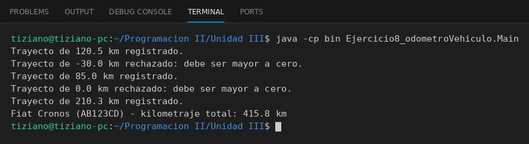

# Vehiculo

Programación II - Unidad 3 - Ejercicio 8

## Consigna
Modelar la clase aplicando encapsulamiento: atributos privados y métodos públicos que validan antes de modificar el estado. Un odómetro cuyo kilometraje solo puede aumentar.

## Lógica
- Atributos privados `patente`, `modelo` y `kilometrajeAcumulado`.
- `avanzar(km)` rechaza valores menores o iguales a cero.
- No existe `setKilometraje`; solo `getKilometraje()` para leer.
- `Main` simula trayectos válidos e inválidos.

## Ejecución

